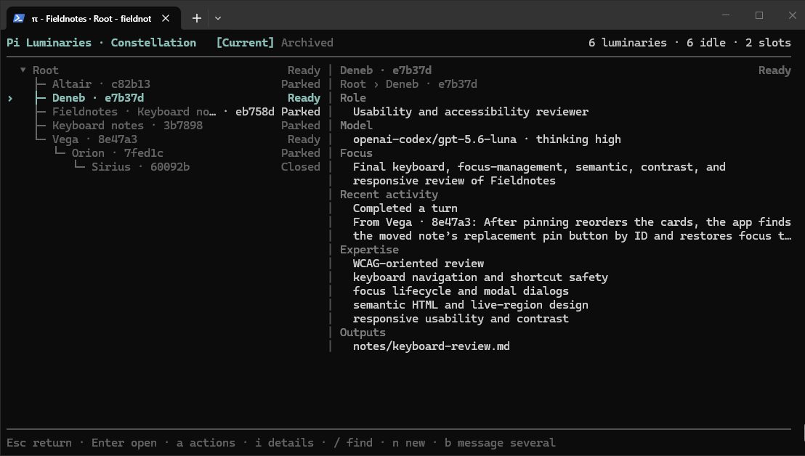
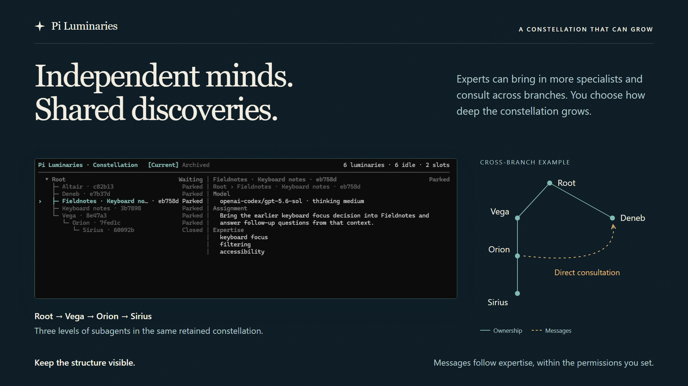

<div align="center">


**Keep the expert who found the answer.**

[Get started](#get-started) · [Your constellation](#your-constellation) · [Usage guide](docs/usage.md) · [Reference](docs/reference/README.md)

</div>

Pi Luminaries gives your Pi session a constellation of enduring experts that can find and talk to one another. Each of these experts is a **luminary**, with its own Pi conversation and a card describing its focus, expertise, and useful work. Return to an expert's conversation days or weeks later.

**Experts can message one another directly.** An expert can use the cards to find someone who has already investigated a relevant area, ask them for help, and continue with the answer. You can open any expert's conversation and guide its work as it happens.

## Get started

[Install and sign in to Pi](https://github.com/earendil-works/pi/tree/main/packages/coding-agent#quick-start), then install Pi Luminaries:

```bash
pi install npm:pi-luminaries
```

Minimum supported Pi version: **0.84.4**.

After updating Pi Luminaries, [exit Pi and resume the same session](docs/reference/troubleshooting.md#restart-after-a-package-update) to load the new runtime.

Start a Pi session in your project. For example, while evolving a notes app:

```text
Use Luminaries to understand how this notes app keeps a user's work safe.
Let experts build up context around the parts they find: local storage,
sync, deletion, and recovery. Have them consult each other where those
behaviors meet, and keep their expert cards current so we can return
to the right expert as the app evolves.
```

Pi Luminaries uses the models and provider access already configured in Pi. Experts can use different models and thinking levels. Each expert's requests count toward your provider's usage or billing.

## Your constellation

Open `/luminaries` to see the constellation and inspect an expert's card. Your original Pi session appears as **Root**.

[](docs/assets/dashboard.png)

The card brings together the expert's role, model, thinking level, current focus, expertise, and outputs. Experts can keep their cards up to date as their work develops, making that knowledge discoverable to you and the other experts.

An expert's model, thinking level, and selected tools can change while its identity and conversation remain.

Open a conversation to read the work, ask a question, or change direction. When a later change needs that knowledge, ask the existing experts:

```text
We're adding shared notebooks. Ask the expert who understands deletion
to consult whoever knows offline edits. What should happen when one
person deletes a note while another is editing it offline?
```

## Experts helping experts

An expert can bring in another for a focused task. Experts can consult one another directly at any level and across branches.



Enable deeper nesting in **Root settings** to let experts add further levels to the constellation. You can change capacity and nesting depth as the work grows, while keeping the same experts and conversations.

## Keep useful expertise available

Idle experts park automatically to free memory. Their cards and conversations remain, and a message wakes the same expert.

A constellation belongs to its owning Pi session. Resume that session to return to it. Close an expert when you want to put its work aside; archive the closed conversation to keep the directory tidy. Its history remains available.

The same idea extends to a longer research project. One expert investigates a promising method and the assumptions behind it. Weeks later, another finds evidence that changes an assumption, discovers the earlier work through its card, and asks that expert to reconsider the result.

## Follow an expert in another terminal

You can work with Root, speak directly to an expert, or follow the same conversation in several terminals. Keep one expert open beside your main Pi session and contribute while the rest of the constellation continues. [Open another terminal →](docs/usage.md#open-another-terminal)

## Move between standalone Pi and a constellation

- **Bring in a Pi session:** adopt an existing Pi conversation as a new expert in your constellation.
- **Continue in standalone Pi:** take an expert's conversation into an ordinary Pi session once its current work has finished.

Both actions create independent copies and preserve the source history. You can bring a standalone conversation back into the constellation later, including the work done since it left.

## Using Pi Luminaries

The [usage guide](docs/usage.md) covers conversations, controls, changing an expert's tools, session handoffs, and additional terminals.

See [Configuration](docs/configuration.md) for models, permissions, nesting limits, and defaults, or [Troubleshooting](docs/reference/troubleshooting.md) for help when something goes wrong.

[Foundations](docs/foundations.md) explains how the pieces fit together. The [capability reference](docs/reference/README.md) describes their behavior in detail for you and your Pi agent.

## Feedback

[Share an idea or report a problem](https://github.com/deepanshu223/pi-luminaries/issues) · [MIT license](LICENSE).
