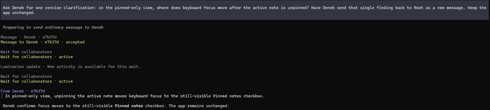
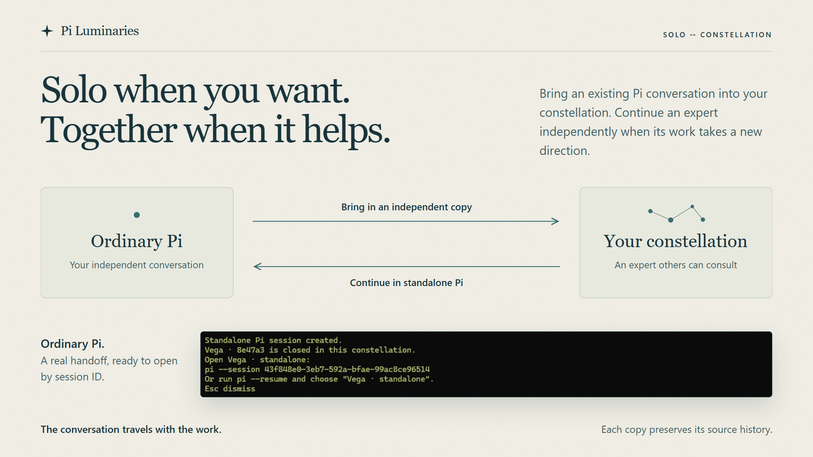

# Using Pi Luminaries

Open `/luminaries` or press `Alt+L` to see your constellation. Your original Pi session is **Root**. Select an expert to inspect its card or open its conversation.

You can ask Pi to coordinate the work, talk directly to an expert, or use both as the work develops. For the underlying relationships, see [Foundations](foundations.md); for exact behavior, see the [capability reference](reference/README.md).

## Find or create an expert

Ask Root for the work you want to continue:

```text
Find the expert who investigated offline edits. Ask it to revisit how
shared notebooks would change those decisions, consulting the expert
who knows deletion where needed.
```

The directory and expert cards help Pi find an existing conversation worth returning to. A message wakes a parked expert. If the work needs a separate conversation, ask Pi to create an expert and describe its assignment and scope.

To create one yourself, press `n` in the dashboard. Supply its first assignment and scope of work. **Customize** offers model, thinking, starting context, and advanced launch options.

For starting-context choices, see [Creation and configuration](reference/creation-and-configuration.md#starting-context).

## Navigate the dashboard

| Key     | Action                                         |
| ------- | ---------------------------------------------- |
| `Enter` | Open the selected conversation                 |
| `/`     | Find an expert by name, expertise, or output   |
| `i`     | Read the selected expert card in full          |
| `n`     | Create an expert                               |
| `b`     | Choose several experts to message              |
| `a`     | Open actions for the selected entry            |
| `v`     | Switch between Current and Archived            |
| `Esc`   | Return to the directory or leave the dashboard |

The mouse wheel scrolls the view. In Pi's fullscreen mode, drag to select text; Pi copies the selection by default. In regular mode on Windows Terminal, hold `Shift` while dragging, then use the terminal's Copy action.

After pressing `b`, use `Space` or `t` to mark each recipient. In this picker, `a` selects all recipients or clears the selection. Press `Enter` to compose one message for the marked experts, or `Esc` to cancel.

## Talk to an expert

Open its conversation and send a message, or ask Root to consult it. For steering, queued follow-ups, and interruption, see [Guide work and understand delivery](#guide-work-and-understand-delivery).

In either TUI mode, `Page Up` and `Page Down` scroll the conversation without changing your draft. `Ctrl+Page Up` and `Ctrl+Page Down` navigate within the editor. These are Pi's default keybindings.

An expert shows **Compacting** while Pi summarizes its conversation to make room for continued work, then returns to its normal activity status.

Incoming messages have a distinct sender heading and a compact preview. Pi's expand/collapse shortcut (`Ctrl+O` by default) reveals the complete message alongside expanded tool output.



Root asks Deneb about keyboard focus. Deneb's answer appears under **From Deneb**, followed by Root's summary.

## Guide work and understand delivery

Use an ordinary message for most conversation. For example, “Also consider edits made while offline” adds useful direction to work already underway.

| You want to…                                   | Use                           | What happens                                                                                                    |
| ---------------------------------------------- | ----------------------------- | --------------------------------------------------------------------------------------------------------------- |
| Ask a question or add direction                | Send a message                | Starts work when Ready, wakes a Parked expert, or reaches a working expert at its next safe model boundary.     |
| Let the current turn finish first              | Queue a follow-up             | Holds the input for the next turn. The recipient must still have a running turn when the follow-up is accepted. |
| Stop the selected expert's current turn        | Interrupt                     | Requests that turn stop. Actions already completed are not undone.                                              |
| Share information without asking for work      | Ask Pi to send a notification | Records the information without starting a model turn.                                                          |
| Ask another expert for an answer you depend on | Ask Pi to make a request      | Associates the answer with the request so the requester can continue when it arrives.                           |

During a turn, new direction reaches the expert between model calls, after current tool work finishes. This is the safe model boundary.

In an expert's conversation, use Pi's follow-up keybinding to queue your draft: `Alt+Enter` by default, or `Ctrl+Q` on Windows and WSL. To interrupt, use `Ctrl+C` with an empty editor. `Esc` returns from the Luminaries view; outside it, Pi's normal conversation controls apply.

Root can also guide or interrupt descendants it owns. Peer messages can cross branches, while direct controls follow [ownership and permissions](reference/ownership-and-permissions.md).

“Accepted” confirms that your message was recorded for delivery. Open the expert's conversation to follow its progress. An expert returns an answer to Root by sending a message or replying to its request.

A message can arrive after its sender has finished, particularly when Root was busy or compacting.

Interrupting Root's turn leaves other experts running. Ending a request's wait, through cancellation or a deadline, also leaves the recipient's existing work running. Ask Root to interrupt an owned expert when you need to stop that work. See [Requests and waits](reference/requests-and-waits.md) for late replies and wait behavior.

## Read and update an expert card

Press `/` to search names, expertise, and published outputs. Select an expert and press `i` to read the complete card, including its model and thinking level. Open the conversation when you want to inspect the investigation behind it.

Ask an expert to update its focus, expertise, or useful output references as its work develops. Root can also change a descendant's assignment, scope, or name. For manual edits, select **Actions → Edit expert card**.

## Change model or thinking

Ask Root to change the selected expert's model or thinking level, or choose **Change model** or **Change thinking** from that expert's actions when it is **Ready** or **Parked**.

You continue with the same expert and conversation. Available models and provider access come from Pi. See [Models and thinking](configuration.md#models-and-thinking).

## Return to a constellation

Resume the saved Pi session that owns it. The experts keep their identities and histories.

- **Parked:** after about five idle minutes, an expert releases its process to free memory. An ordinary message wakes the same Pi session.
- **Closed:** its conversation remains available, but it needs an explicit **Resume** action before receiving new work.
- **Archived:** a closed expert is hidden from Current. Press `v` to find it in Archived, inspect its history, or unarchive and resume it.

Parking keeps an expert open and still counts toward capacity. Closing frees its place in the constellation.

To park the constellation's experts together, select Root, press `a`, and choose **Park all collaborators**. Choose **At next safe boundary** to let active turns finish before parking, or **Now** to interrupt them and park immediately. Root stays running.

The widget highlights work in progress and experts needing attention. Open `/luminaries` to see the whole constellation.

For an expert showing **Needs you**, open its card and conversation to read the explanation. If its actions offer **Continue with a message**, review what happened and tell it how to proceed. See [Lifecycle and recovery](reference/lifecycle-and-recovery.md#failure-and-recovery) for uncertain delivery and restart behavior.

## Add or remove an expert's extensions

For an approved source, ask Root:

```text
Give the expert investigating browser behavior access to pi-web-access.
Keep its existing conversation.
```

You can also ask Root to remove or replace an owned expert's optional extensions. For example: “Remove its optional web extension now that the research is complete.” Sources marked `always` remain loaded; an empty optional selection removes only the optional sources.

To make the selection manually, open the expert's actions and choose **Extensions**. A working expert finishes its current turn and parks; a parked expert saves the choice immediately. Send the next message to wake the same Pi conversation with the revised selection.

If the source is not available yet, select Root and open **Actions → Root settings → Extension availability**. Choose an installed Pi source or enter a source accepted by `pi install`. Approval makes it selectable without loading it into every expert.

You approve new sources; Root and owning experts can select from those approvals. See [Additional Pi extensions](configuration.md#additional-pi-extensions) for the policy and source formats.

## Bring in an existing Pi session

An investigation you began in ordinary Pi can become an expert that the constellation consults.



1. Select Root, open its actions, and choose **Bring in a Pi session**.
2. Choose a conversation from the current project or **Other projects**, or enter its exact session ID or file path.
3. Optionally name the luminary. Leave the name empty to keep the session's name, or use an automatic star name if the session is unnamed.

Pi Luminaries checks the selected session before asking for a name, then copies its conversation into a new, parked expert. The original Pi session stays independent. Send a message or ask Root to give it work. Root can update its assignment, and the expert can describe its expertise as it works.

## Continue in standalone Pi

Once an expert has finished its current turn, choose **Continue in standalone Pi** from its actions. Pi Luminaries closes its constellation entry, keeps its history, and creates an ordinary Pi continuation.

Use the exact `pi --session` command in the receipt, or run `pi --resume` and choose the readable **Name · standalone** entry. The receipt stays available until dismissed with `Esc`.

You can later adopt that standalone session as a new expert, including its additional work. The original entry and the standalone continuation develop independently; re-adoption does not merge changes into the earlier entry. See [Session handoffs](reference/session-handoffs.md).

## Open another terminal

Open the same live conversation in another terminal to follow an expert while you continue working with Root. Both views receive updates, and you can send input from either.

You can ask your Pi agent to open a selected luminary in another terminal when it has terminal-launching tools. **Open another terminal** in Root's actions provides the commands for you to run.

Keep the owning Pi session running. From another terminal in the same project, open the live constellation:

```bash
pi --luminaries
```

To open one expert, use its short ID from the directory. Replace the example ID below with the one shown beside your expert:

```bash
pi --luminary fa8318
```

A unique name such as `pi --luminary Vega` also works. If names repeat, use the short ID or the complete handle shown in the directory:

```bash
pi --luminary "Vega · fa8318"
```

Closing an attached view leaves the owning session, experts, and other views running. If the owner goes offline, the attached view retains received content, becomes read-only, and attempts to reconnect when that same owning Pi session resumes. See [Shared terminal views](reference/shared-views.md).

For models, thinking levels, permissions, and nesting limits, see [Configuration](configuration.md).
